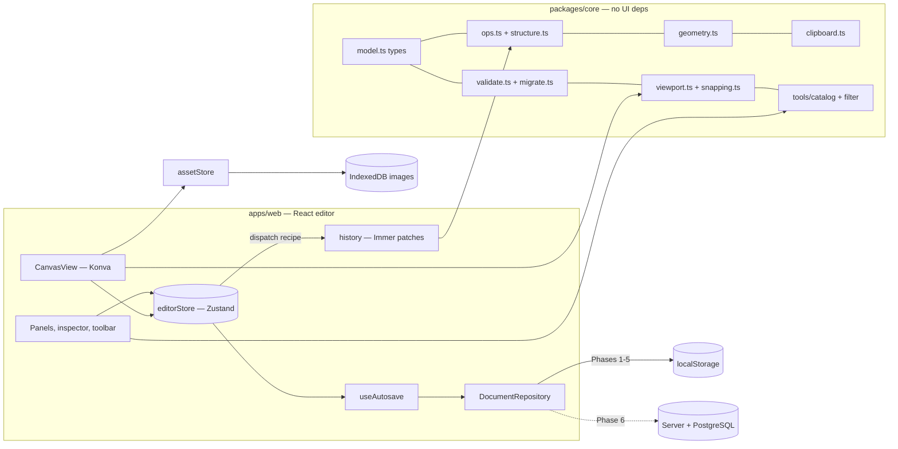

# Architecture

## Overview

**Why a separate `core` package:** the document model and operations will be reused by the
server (validation, persistence), the plugin runtime (Phase 4) and the MCP/agent API (Phase 7).
Keeping them free of React/Konva makes them testable and shareable.

## Document model (`packages/core/src/model.ts`)

| Type | Key fields |
|---|---|
| `DesignDocument` | `id`, `name`, `schemaVersion`, `createdAt`, `updatedAt`, `pages[]`, `nodes: Record<id, SceneNode>` |
| `Page` | `id`, `name`, `background`, `childIds[]` (render order, bottom first) |
| `SceneNode` (all) | `id`, `name`, `pageId`, `parentId`, `x`, `y`, `width`, `height`, `rotation`, `opacity`, `visible`, `locked`, `isMask`, `fills[]`, `strokes[]`, `effects[]` |
| `FrameNode` | + `childIds`, `cornerRadius`, `clipContent` |
| `GroupNode` | + `childIds` (its box always wraps the children) |
| `RectangleNode` | + `cornerRadius` |
| `EllipseNode` | — |
| `PolygonNode` / `StarNode` | + `pointCount` (star: + `innerRadius`) |
| `LineNode` | + `startCap`, `endCap`; runs from (0,0) to (`width`,0); `height` is always 0 |
| `VectorNode` | + `vertices[]` (x, y and bezier handle offsets), `closed` |
| `TextNode` | + `characters`, `fontFamily`, `fontSize`, `fontWeight`, `italic`, `textAlign`, `lineHeight`, `letterSpacing`, `textDecoration`, `autoResize` |
| `ImageNode` | + `assetId`, `naturalWidth/Height`, `fit` (fill/fit/stretch/crop), `crop`, `cornerRadius` |
| `ComponentNode` | frame-like + `description`, `variantProps` (main component / variant) |
| `ComponentSetNode` | frame-like; holds the variants of one component |
| `InstanceNode` | frame-like + `componentId`; its layers carry `componentNodeId` and `overrides` |

All nodes (v3) also have `constraints`, `sizing` (fixed/hug/fill per axis), `minWidth/maxWidth/
minHeight/maxHeight` and optional `bindings` (property -> variable). Frame-likes have `layout`
(auto layout or null) and optional `variableModes`. The document has `variableCollections` and
`variables`.

Fills and strokes are lists painted bottom-first. Effects: one drop shadow and one layer blur.

- **Normalised:** nodes live in one flat map; hierarchy is `parentId` + ordered `childIds`.
  Lookups are O(1), undo patches are small, and real-time sync (Phase 7) can address nodes by id.
- **Coordinates:** `x`/`y` are relative to the parent (or page). Rotation in degrees around the
  node's top-left corner (matches Konva).
- **Transforms:** `geometry.ts` turns x/y/rotation into affine matrices. Every structural op
  (reparent, group, ungroup, paste into another parent, align) keeps the page-space position by
  converting through the parents' world matrices, so rotated frames behave correctly.
- **Outlines:** every shape produces path commands (M/L/C/Z) from `nodeOutline`; the same data
  renders on canvas, clips masks, and will feed SVG export (Phase 7).
- **Schema versions:** `migrateDocument` upgrades stored files one version at a time (v1 -> v2
  added `isMask` and the new node types), then runs a full structural check (`validate.ts`:
  field types, ranges, parent/child links, no cycles or orphans). Damaged files report the reason
  instead of opening half-broken.
- **Components** (`components.ts`): an instance stores real child layers so selection, rendering
  and editing need no special cases. Each instance layer points at the layer it mirrors
  (`componentNodeId`) and lists locally changed properties (`overrides`). `syncInstances` rebuilds
  structure and copies non-overridden properties; when the instance's size differs, layer geometry
  follows constraints. Nested instances mirror the matching nested instance of their source, so
  overrides made inside a main component carry into its instances. Cycles (a component containing
  itself, directly or through instances) are refused on insert and detached on load. Structure
  inside an instance is read-only (`INSTANCE_STRUCTURE_ERROR`).
- **Auto layout** (`layout.ts`): rows/columns with gap, padding, alignment, space-between, fixed /
  hug / fill sizing and min/max. Children are laid out before parents so "hug" sizes are known.
- **Constraints** (`structure.ts`): resizing a frame without auto layout moves/resizes children by
  left/right/left-right/center/scale (and the vertical equivalents).
- **Variables** (`variables.ts`): typed values per mode in collections; bound properties are written
  from the mode chosen by the nearest frame (`variableModes`), else the collection default.

## State and undo

- `editorStore` holds the document, active page, selection, current tool, viewport.
- All document changes go through `dispatch(label, recipe, { coalesceKey? })`. The recipe calls
  pure ops from `core`; Immer's `produceWithPatches` records patches + inverse patches per step.
- Rapid repeated edits with the same `coalesceKey` within 1s merge into one undo step
  (arrow-key nudges, dragging a colour picker).
- Ops never touch `updatedAt`, so a no-op edit records nothing; the repository stamps
  `updatedAt` at save time.
- After every recipe, `finalizeDocument` (core `finalize.ts`) restores derived state inside the
  same undo step: instances sync -> variables apply -> text boxes fit -> auto layout runs (twice,
  so fill sizes feed back) -> groups wrap their children. Unchanged values are not written, so a
  no-op edit adds no undo entry.
- `editor/commands.ts` holds every user command (copy, paste, group, mask, align, ...). Shortcuts,
  the context menu, the toolbar and the inspector all call these, so behaviour is identical
  everywhere.
- `uiStore` holds per-browser preferences (navigation state, toggles, profile name, tool installs)
  and persists them with Zustand's `persist` middleware.

## Rendering

- `CanvasView` = one Konva `Stage`: a grid layer (screen space, not listening) and a content
  layer whose root `Group` applies the viewport transform (`screen = world * zoom + offset`).
- `SceneRenderer` renders each node as a Konva `Group` (position/rotation/opacity). Shapes are
  `Path`s built from the node outline, drawn once per visible fill and once per stroke. Text uses
  Konva `Text` with the same props the measurer uses; images use Konva `Image` with crop maths for
  fill/fit/stretch/crop. A visible mask wraps the siblings above it in a group clipped to the
  mask's outline. Layer blur caches the node and applies a blur filter.
- Memoisation relies on Immer structural sharing: an unchanged node object skips rendering.
- Pointer handling lives in `CanvasView`. Moves are done by hand (not Konva dragging) so the whole
  selection moves together, smart guides (`snapping.ts`) can adjust the delta, and the drop-target
  frame can be found; the result is one undoable "Move" (plus reparent) step.
- Selection rules (`selectionRules.ts`): a click inside a group selects the group until the group is
  entered (double-click); top-level frames with content act as artboards (their empty area starts
  a marquee; select them by their name label).
- Konva's `Transformer` provides resize/rotate handles; results are written back as one undo step.
- Rulers are two small HTML canvases redrawn on viewport change.

## Persistence

`DocumentRepository` (`list/load/save/delete`) is the storage boundary.
Phases 1-5: `LocalDocumentRepository` (localStorage, migrated and validated on load).
Autosave debounces 800ms after the last edit and flushes on tab hide/close; Ctrl+S saves now.

Images are stored separately in IndexedDB (`assetStore.ts`, see ADR 0003). Imports are checked by
their first bytes (PNG/JPEG/GIF/WebP only; SVG is refused because it can carry scripts), limited
to 20 MB and 16384 px per side, and keyed by SHA-256 so the same image is stored once.

Clipboard: copied layers go to the system clipboard as JSON (`clipboard.ts`), so they can be
pasted into another tab. Pasted JSON is untrusted and is fully validated (structure, ranges,
node count) before use. Pasting image files or plain text creates image or text layers.

## Tools and plugin runtime

- **Shared API:** built-in tools (`editor/plugins/builtinTools.ts`) and custom tools use the same
  `ToolContext` (`toolHost.ts`).
  - It checks the tool's declared permissions on every call.
  - It validates input. New layers go through `nodeFromSpec`. Updates are limited to existing,
    non-protected fields and re-checked with `nodeProblem`.
  - It records all edits of one run as a single undo step.
- **Running custom tools:** `sandbox.ts` runs custom code in a Worker inside a sandboxed iframe
  with a no-network CSP.
  - Calls arrive as `postMessage` RPC against a fixed allow-list.
  - Limits: time, message count, data size, layers, vector points, characters and images per run.
  - Downloads need a confirming click.
  - See [ADR 0004](adr/0004-plugin-sandbox.md).
- **Entry point:** `runTool.ts` picks the built-in implementation or the sandbox, records the run
  and brings off-screen results into view. `ToolDialogs.tsx` holds the parameter form, the custom
  tool editor and the slide/flipbook players.
- **Storage:** custom tools are saved per browser in `customToolsStore` (localStorage).

## Prototyping

- Layers carry `interactions` (trigger + action + transition), screens (top-level frames) an
  optional `scroll` mode, and pages a `flowStartId`. These are optional fields, so older files load
  unchanged (schema version not bumped). `nodeProblem` validates them; links only open http(s)
  and mailto URLs.
- `core/prototype.ts` holds the rules: `pruneInteractions` (in `finalizeDocument`) drops links to
  deleted screens; `applyAction` is the player's pure state machine (screen history + overlay
  stack) and returns the effect to play; `hitInteraction` finds the interactive layer under a point.
- `PrototypePlayer` (Present route) renders each screen with the editor's `SceneNodes`, plays
  transitions with the Web Animations API (respecting reduced motion) and handles hover/press
  reverting. The canvas draws links while the Prototype tab is open (`PrototypeConnections`).

## Server (Phase 6)

- `apps/server`: Fastify API under `/api`, with JSON-schema validation on every route. The web dev
  server proxies `/api` to it.
- Database: one small `Db` interface over `pg` (when `DATABASE_URL` is set) or embedded PGlite.
  Migrations live in `migrations.ts` and run at start-up. Tables: users, sessions, projects,
  project_members, folders, files, file_versions, assets. See ADR 0005.
- Auth:
  - scrypt password hashes.
  - Random session tokens in an httpOnly SameSite=Lax cookie; only their SHA-256 is stored.
  - Every non-GET request needs an `X-Requested-With: canvas-studio` header (CSRF).
  - Login/sign-up attempts are rate-limited.
- Access: roles per project (owner / editor / viewer), checked in `access.ts`. Non-members get
  404, so ids cannot be probed.
- Files:
  - The document JSON is validated with the core `migrateDocument` on every write.
  - Saves carry `baseRevision`; a stale save gets 409.
  - An automatic version is kept at most every 10 minutes (the last 50 are kept), plus named
    versions. Restoring keeps the current state as a version first.
- Images: stored per project, keyed by SHA-256. The server checks the hash and the real file type
  (PNG/JPEG/GIF/WebP). Downloads are limited to project members.
- Web side:
  - `ServerDocumentRepository` and `ServerAssetStore` implement the existing storage interfaces.
  - `AuthGate` wraps all routes.
  - Viewers get a read-only editor (`editorStore.readOnly`).

## Routes

| Path | Screen |
|---|---|
| `/` | File browser (recent files, projects, folders, sharing) |
| `/file/:docId` | Editor |
| `/file/:docId/present` | Presentation mode |

## Decision records

See [docs/adr](adr/).
